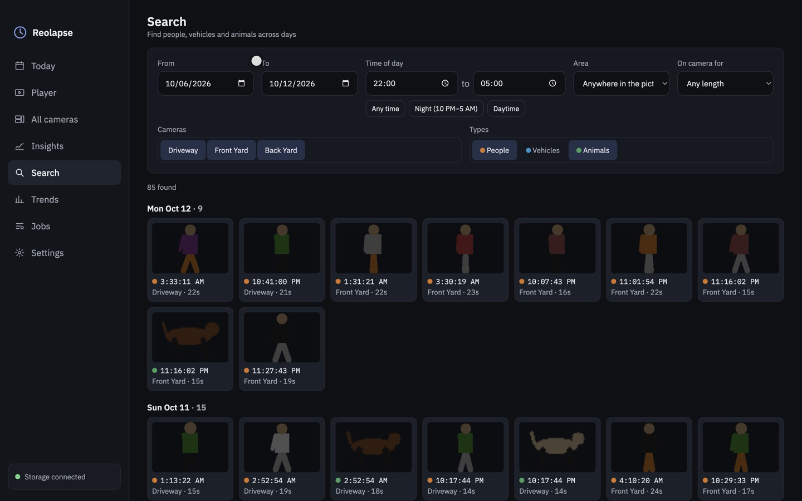
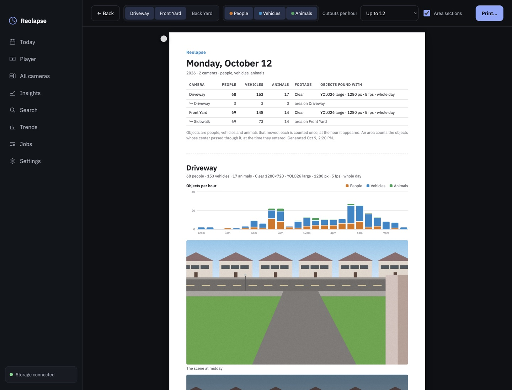

# Reolapse

**A whole day of motion from a Reolink camera, in a few minutes of video.**

Reolapse downloads a day of continuous recordings from a Reolink NVR, finds every person, vehicle and
animal that moved, cuts each one out of its original moment, and replays them all over a time-lapse of
the empty scene: each one near its real time of day, tagged with when it was really there. A 24-hour
day becomes a few minutes of *synopsis* video, plus pictures, charts, searches and a printable report.


It runs on a Mac (Apple Silicon) as a desktop app, keeps your recordings on your own disk or NAS, and
never sends footage anywhere. *The pictures in this README come from a synthetic demo day
([tools/make_demo.py](tools/make_demo.py)), not from real cameras.*


---

## What it does

| | |
|---|---|
|  | **Today**: one card per camera: how many people, vehicles and animals, when the day was busiest, which stream and model it was processed with. |
|  | **Player**: the synopsis in *cutout*, *ghost* or *outline* style; everything or just people, vehicles or animals; an *adaptive* or *even* clock; zoom. Click the activity graph to jump there and see the **original footage** from that moment. |
|  | **Find in area**: draw boxes on the picture and get every object that passed through, with its cutout and time. Save an area to get its own section in reports. |
|  | **All cameras**: every camera's real recording from the same second, played together; pick an event on any camera and all of them jump to it. |
|  | **Insights**: every path of the day colored by time, a heatmap and a "group shot" of everyone who came by, for everything or one type. |
|  | **Search**: across days by time of day (e.g. people between 10 PM and 5 AM), camera, type, area and how long they stayed. |
|  | **Trends**: objects per day, an hour-by-day heatmap, per camera and per area. |
|  | **PDF report**: a printable day: counts, objects per hour, the day's pictures, every detection grouped by hour, and a section per saved area. |
|  | **Jobs**: download, find objects and render, in two lanes side by side, with readable logs; reorder, retry, pause and resume without losing work; a **nightly run** that queues yesterday by itself. |
|  | **Settings**: NVR login (in the Keychain), cameras and streams, per-camera analysis settings and **ignore zones**, rendering, storage use and **automatic cleanup**, updates. |

Fix what the detector got wrong with ✎ on any object (*Person / Vehicle / Animal / Not an object*);
counts, searches, reports and the next render follow.

The three synopsis styles, at the same moment:

| Cutout | Ghost | Outline |
|---|---|---|
|  |  |  |

## Install

1. Download **Reolapse-x.y.z-mac-arm64.dmg** from [Releases](../../releases) and drag **Reolapse** to
   **Applications** (macOS 13+, Apple Silicon).
2. The app isn't notarized by Apple, so macOS blocks the first launch. Open **System Settings →
   Privacy & Security** and click **Open Anyway**, or run
   `xattr -dr com.apple.quarantine /Applications/Reolapse.app` once.
3. On first launch Reolapse sets up its analysis engine (about 1.5 GB, a few minutes; once per version).
4. In **Settings**: enter your NVR's address and login, choose the cameras, set the **archive folder**
   (e.g. a NAS share such as `/Volumes/NAS/Reolapse`; default `~/Movies/Reolapse`) and the **working
   folder** (*Use this Mac's drive*), then **Save changes**.
5. In **Jobs**, pick a day, choose *Everything*, and queue it, or switch on the **nightly run**.

**Updating:** Settings → **Updates** checks this repository's releases and downloads the new `.dmg`;
open it and drag Reolapse onto Applications to replace the old version. Settings, login, queued jobs
and processed days carry over.

The **[User guide](docs/USER_GUIDE.md)** covers every screen and setting, what the Fluent/Clear and
detector choices cost, the job queue, and troubleshooting.

## Requirements and what to expect

- A **Reolink NVR** recording **24/7** on your network. Only fixed cameras work: pan/tilt tracking
  lenses can't make a synopsis because their background moves.
- Room for footage: a day of *Fluent* (sub stream) footage is about 2–21 GB per camera; *Clear* (main
  stream) about 36–90 GB. Automatic cleanup keeps it within the limits you set.
- An **Apple Silicon Mac** (16 GB is plenty). A whole day per camera takes from under an hour (Fluent,
  small model) to several hours (Clear, large model at a big detector size); the queue can be paused and
  resumed at any time without losing progress, and two Macs can share the work.

## How it works, briefly

**Download** the day's recordings → **find moving objects** (a cheap motion check picks the frames that
go to a YOLO segmentation model on the Mac's GPU; objects are tracked; parked cars are ignored, because a
vehicle has to travel at least half its own size to count; and each moving object becomes a *tube* of
cutouts) → **render** (tubes are placed over 10-minute background medians near their real time of day,
on a clock that gives busy hours more of the video). The full picture, the command line, the local API
and how releases are built are in **[docs/DEVELOPMENT.md](docs/DEVELOPMENT.md)**.

## Command line

Everything the app does also works from a source checkout:

```
uv run reolapse probe                    # check the NVR connection; a day's events and sizes
uv run reolapse run --day 2026-10-01     # download, find objects and render one day
uv run reolapse render --day 2026-10-01 --only person   # a people-only video
uv run reolapse cleanup --dry-run        # what the retention settings would delete
uv run reolapse serve                    # the local API and UI at http://127.0.0.1:8765
```

## Privacy

Recordings, cutouts and videos stay on your Mac and your archive folder; the NVR password is kept in
the macOS Keychain. Nothing is uploaded. The images and videos in this repository are synthetic.
