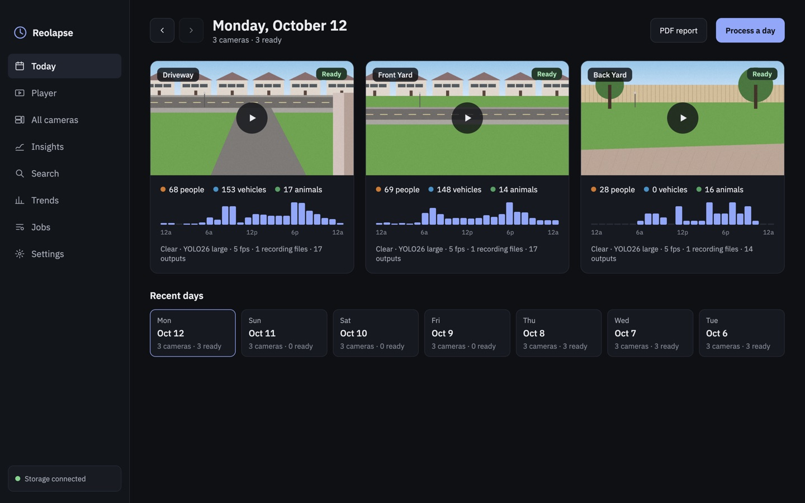
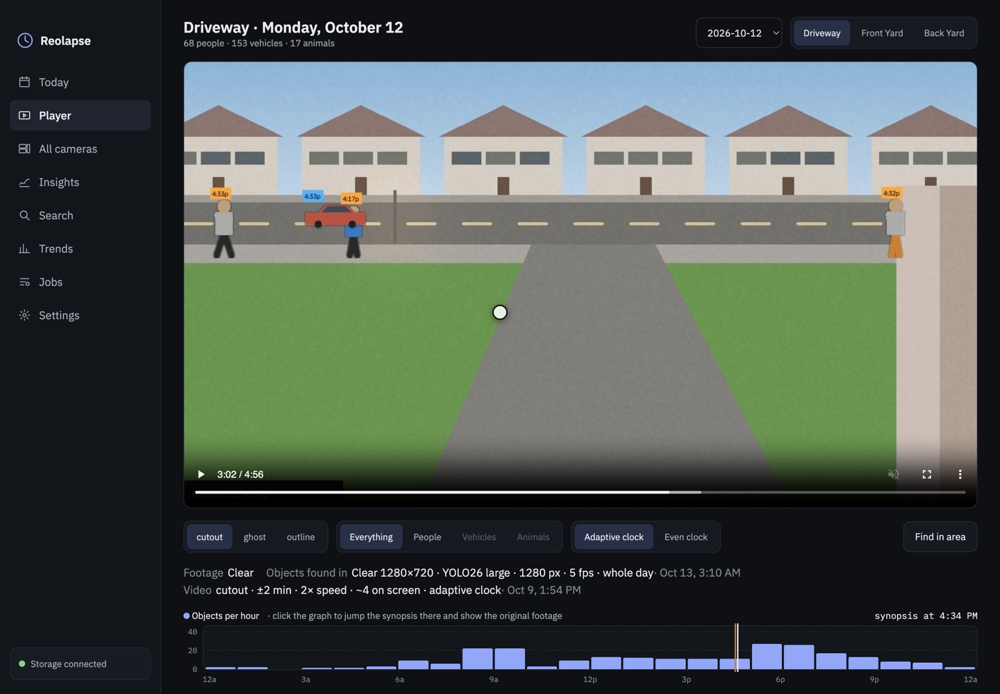
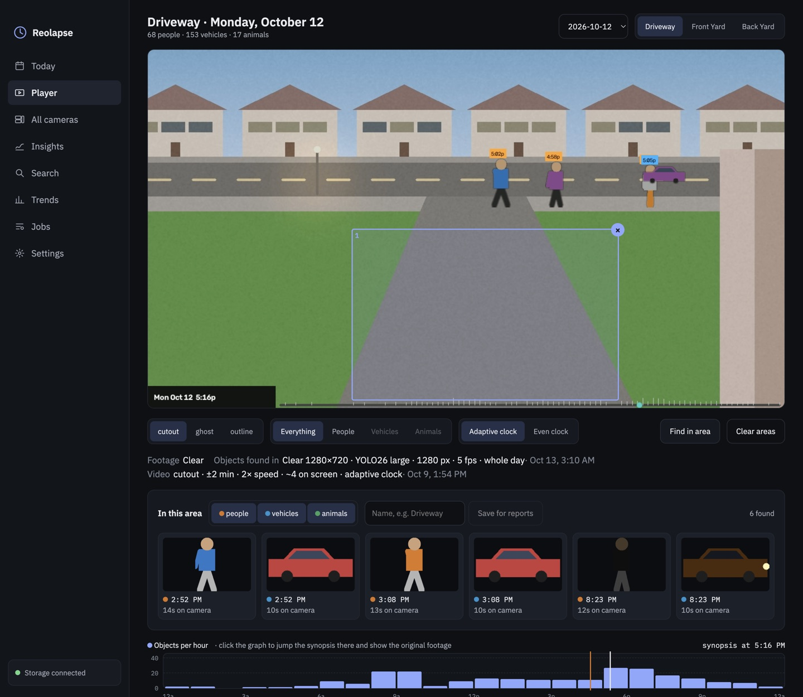
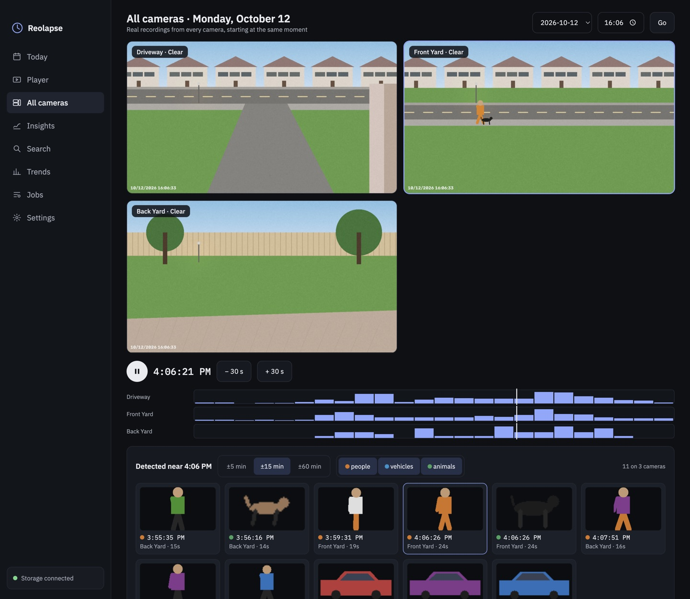
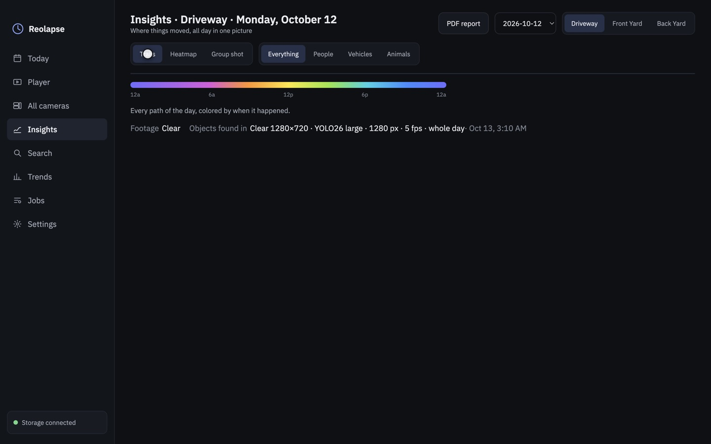
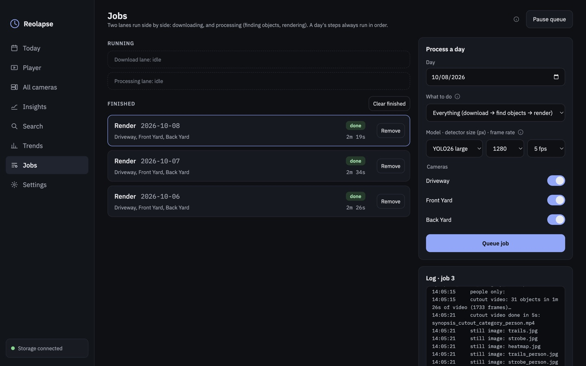
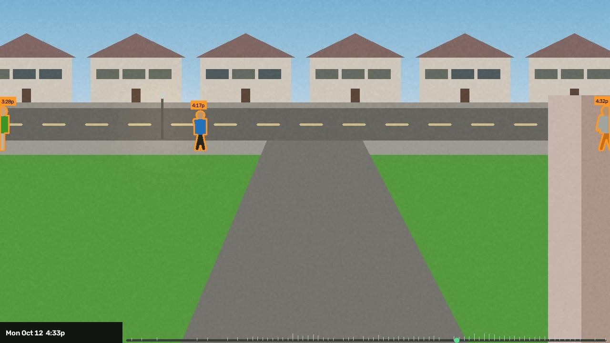

# Reolapse

**A whole day of motion from a Reolink camera, in a few minutes of video.**

Reolapse downloads a day of continuous recordings from a Reolink NVR, finds every person, vehicle and
animal that moved, cuts each one out of its original moment, and replays them all over a time-lapse of
the empty scene: each one near its real time of day, tagged with when it was really there. A 24-hour
day becomes a 5–10 minute *synopsis* video, plus stills that show where everything went.


It runs on a Mac (Apple Silicon) as a desktop app, keeps your recordings on your own NAS share, and
never sends footage anywhere.

---

## What it does

| | |
|---|---|
|  | **Today**: one card per camera with a preview, how many people, vehicles and animals were seen, and when the day was busiest. |
|  | **Player**: watch the synopsis in *cutout*, *ghost* or *outline* style. Click the activity graph to jump to any time and see the **original footage** from that moment underneath. |
|  | **Find in area**: draw boxes on the picture (the driveway, the front door…) and get every object that passed through, with a cutout and the time; click one to jump there. |
|  | **All cameras**: every camera's real recording from the same second, played together. Pick an event detected on any camera and all of them jump to it, so you can follow someone from one view to the next. |
|  | **Insights**: every path of the day colored by time, a heatmap of where things moved, and a "group shot" of everyone who came by. |
|  | **Jobs**: download, find objects and render, in two lanes that run side by side, with live progress, readable logs, reordering, retry, and pause/resume (automatic when the laptop leaves home). |

The three synopsis styles, at the same moment:

| Cutout | Ghost | Outline |
|---|---|---|
|  |  |  |

## Install

1. Download **Reolapse-x.y.z-mac-arm64.dmg** from [Releases](../../releases) and drag **Reolapse** to
   **Applications** (macOS 13+, Apple Silicon).
2. The app isn't notarized by Apple, so macOS blocks the first launch. Open **System Settings →
   Privacy & Security** and click **Open Anyway**, or run
   `xattr -dr com.apple.quarantine /Applications/Reolapse.app` once.
3. On first launch Reolapse sets up its analysis engine (about 1.5 GB, a few minutes; once per version).
4. In **Settings**: enter your NVR's address and login (kept in the macOS Keychain), choose the cameras,
   and set the **archive folder** on your share (e.g. `/Volumes/Photos/ReoLink`) and the **working
   folder** (*Use this Mac's drive*).
5. In **Jobs**, pick a day, choose *Everything*, and queue it.

The **[User guide](docs/USER_GUIDE.md)** covers every screen and setting, what the Fluent/Clear and
detector choices cost, the job queue, and troubleshooting.

## Requirements and what to expect

- A **Reolink NVR** recording **24/7** on your network. Only fixed cameras work: pan/tilt tracking
  lenses can't make a synopsis because their background moves.
- A **NAS share** (or any folder with room). A day of *Fluent* footage is about 2–21 GB per camera;
  *Clear* is about 36–90 GB per camera.
- An **Apple Silicon Mac**. With the default settings (Fluent, 5 fps, nano model) one camera-day took
  45–90 minutes to analyze on an M2. Clear footage and bigger models take many hours, but the queue
  can be paused and resumed at any time without losing progress.

## How it works, briefly

**Download** the day's recordings → **find moving objects** (a cheap motion check picks the frames that
go to a YOLO segmentation model on the Mac's GPU; objects are tracked, parked cars are ignored, and each
moving object becomes a *tube* of cutouts) → **render** (tubes are placed over 10-minute background
medians near their real time of day). The full picture, the command line, the local API and how releases
are built are in **[docs/DEVELOPMENT.md](docs/DEVELOPMENT.md)**.

## Command line

Everything the app does also works from a source checkout:

```
uv run reolapse probe                    # check the NVR connection; a day's events and sizes
uv run reolapse run --day 2026-10-01     # download, find objects and render one day
uv run reolapse serve                    # the local API and UI at http://127.0.0.1:8765
```

## Privacy

Recordings, cutouts and videos stay on your Mac and your share; the NVR password is kept in the macOS
Keychain. The screenshots in this repository show real footage, so keep the repository private or
replace them before publishing it.
