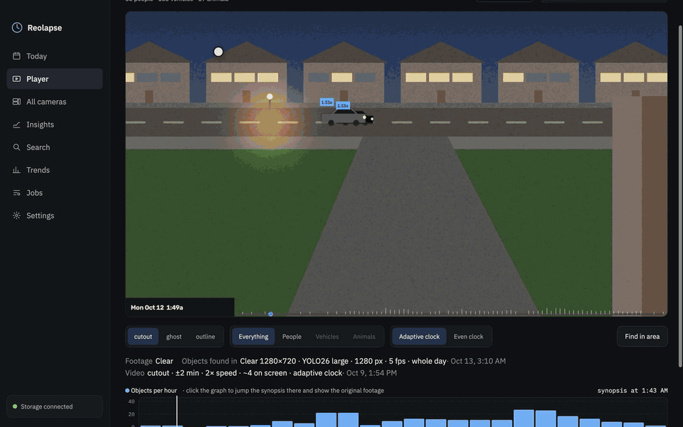
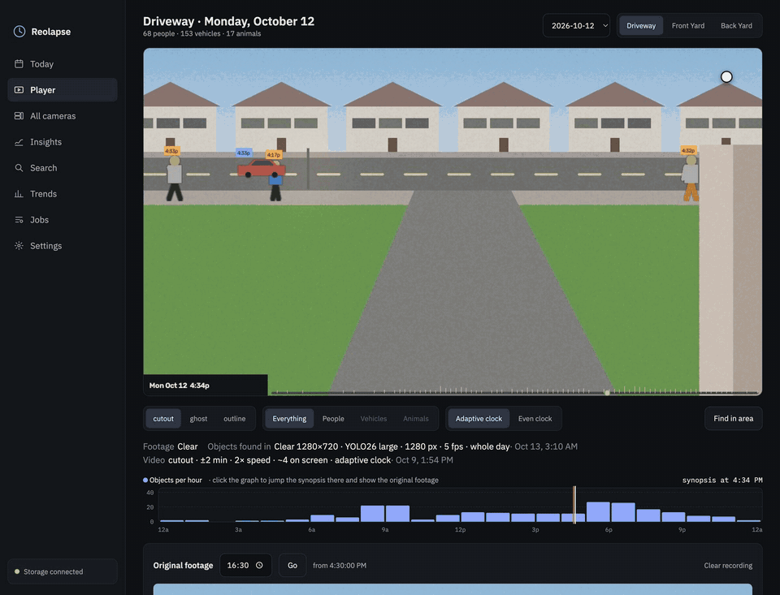
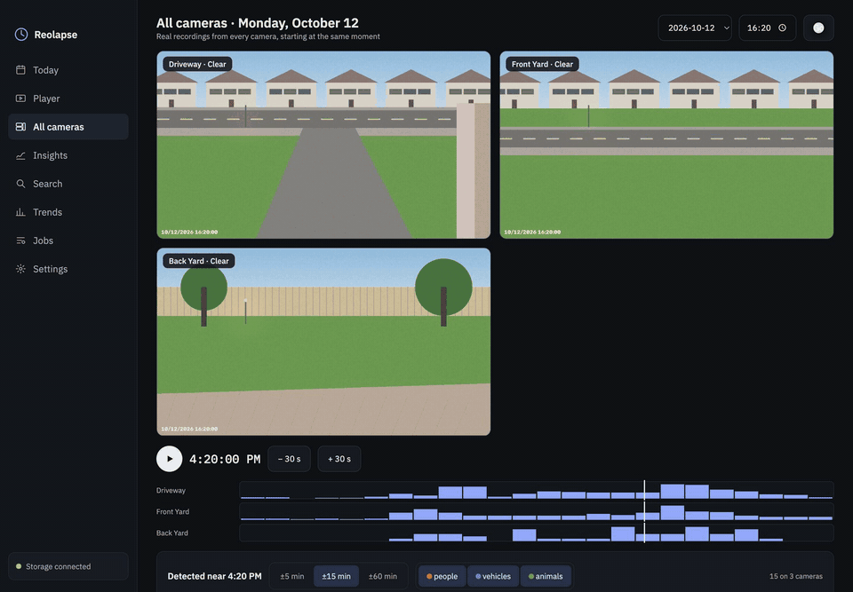
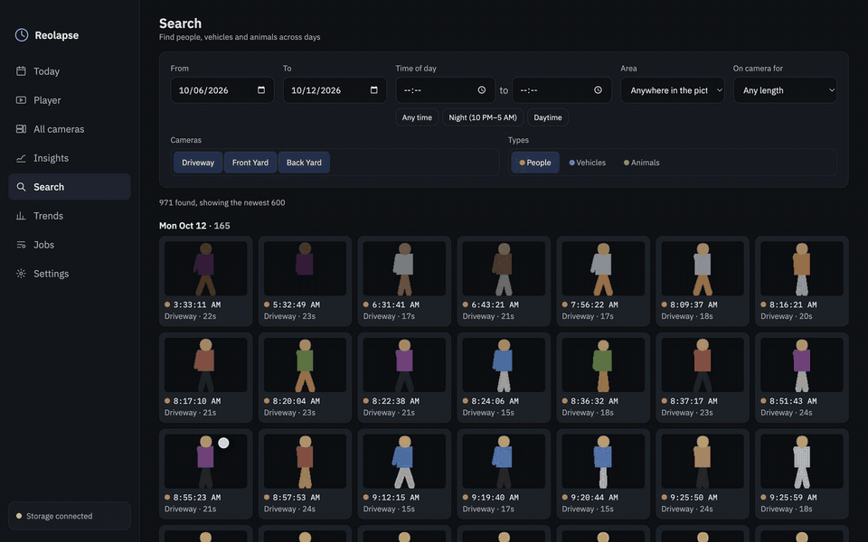
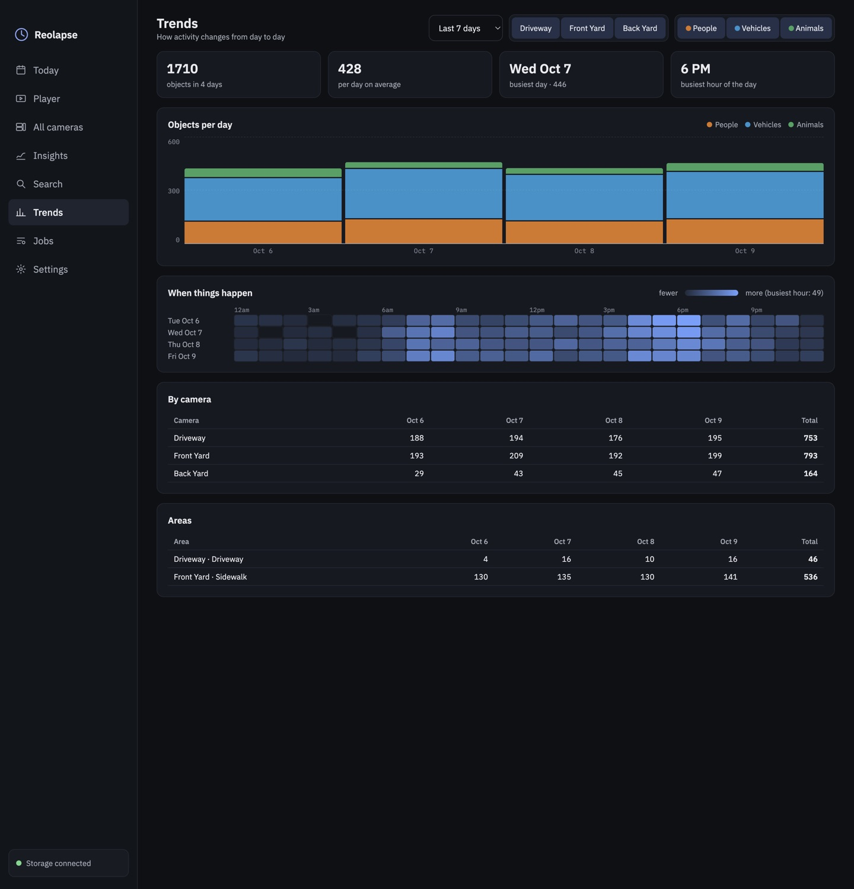
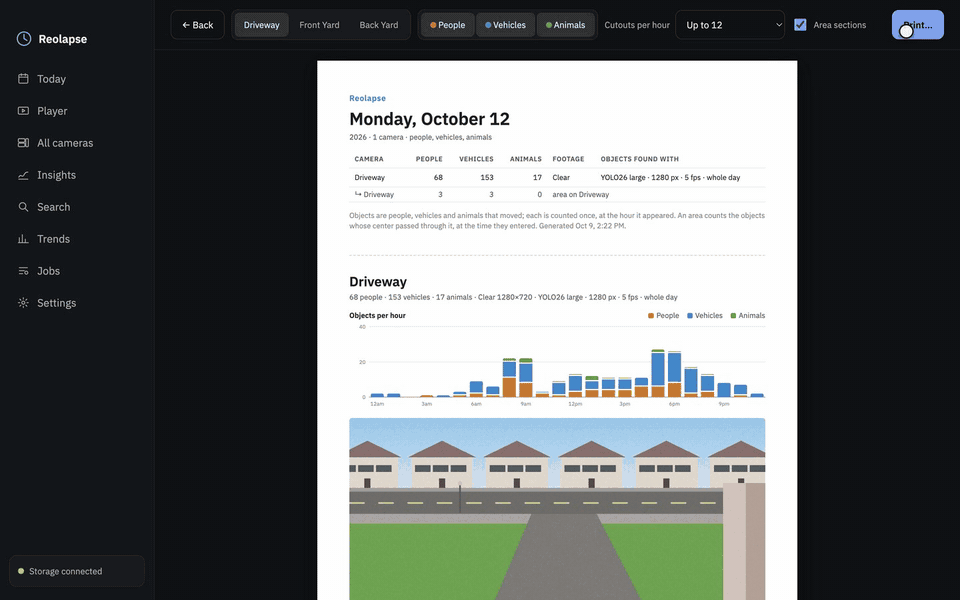
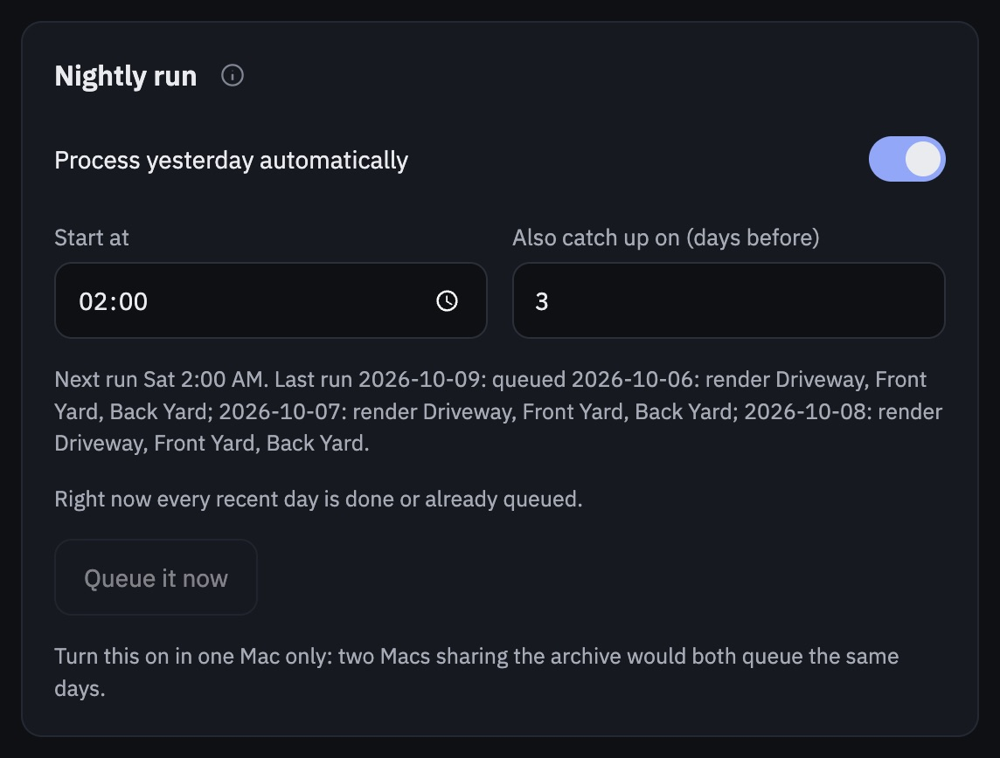
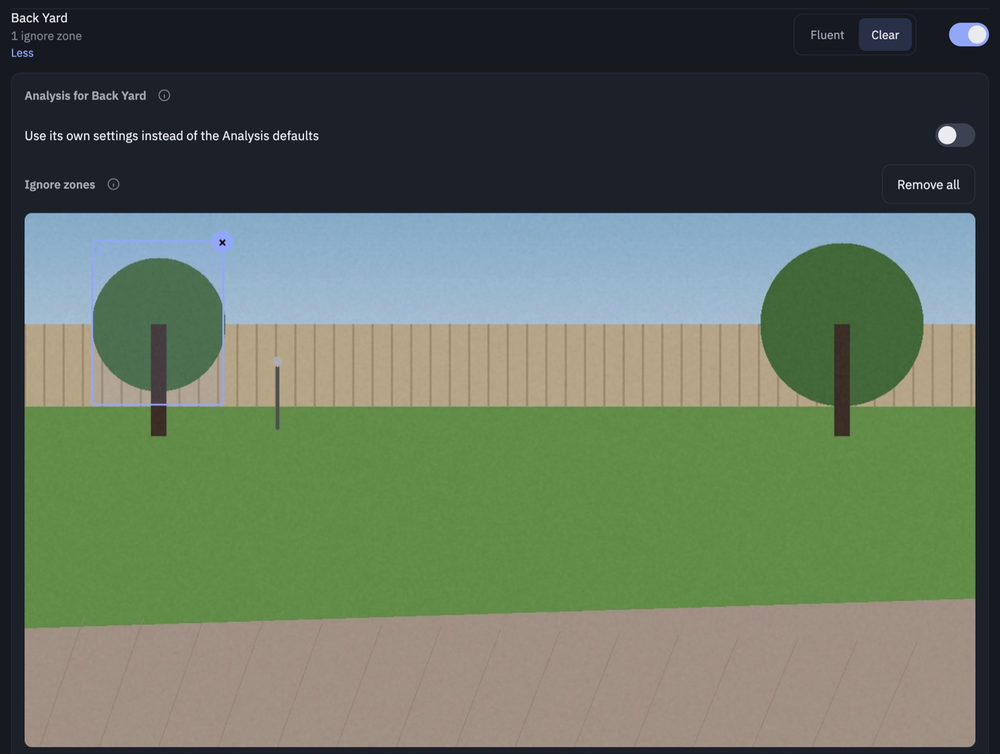
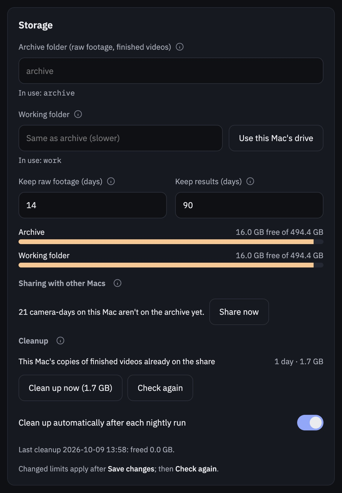

# Reolapse user guide

*Screenshots and videos here come from a synthetic demo day ([tools/make_demo.py](../tools/make_demo.py)).*

- [First run](#first-run)
- [Today](#today)
- [Player](#player): styles, people/vehicles/animals, the clock, zoom, [Find in area](#find-in-area)
- [All cameras](#all-cameras)
- [Insights](#insights)
- [Search](#search) and [Trends](#trends)
- [PDF report](#pdf-report) and [areas](#areas)
- [Correcting objects](#correcting-objects)
- [Jobs](#jobs): lanes, pausing, the [nightly run](#nightly-run), logs
- [Settings](#settings): NVR, cameras, [ignore zones](#ignore-zones), analysis, rendering,
  [storage and cleanup](#storage-and-cleanup), [two Macs](#two-macs), [updates](#updates)
- [What counts as a moving object](#what-counts-as-a-moving-object)
- [How long things take](#how-long-things-take)
- [Troubleshooting](#troubleshooting)

---

## First run

1. Install the app from the `.dmg` (see the [README](../README.md#install)); the first launch builds the
   analysis engine (about 1.5 GB; a setup window shows progress). It is stored in
   `~/Library/Application Support/Reolapse` and reused until the next version.
2. Open **Settings**:
   - **NVR connection**: the NVR's address, a username and password, **Save login**, then **Test
     connection**. Use a dedicated NVR user with viewing/playback rights. The password can't contain
     `& # %` or spaces (the NVR's web API breaks on them); it is kept in the macOS Keychain.
   - **Cameras**: after a successful test every NVR camera is listed; switch on the fixed ones you want
     and choose **Fluent** or **Clear** for each.
   - **Storage**: the **archive folder** (downloads and finished videos, normally a NAS share) and the
     **working folder** (*Use this Mac's drive* is fastest).
   - **Save changes**.
3. Open **Jobs**, pick yesterday, keep *Everything*, **Queue job**. Or switch on the
   [nightly run](#nightly-run) and let it do this every night.

## Today

One card per camera for the selected day: a picture of the scene, a status (*Downloaded*, *Analyzed*,
*Ready*), counts of people, vehicles and animals, a 24-hour activity chart, and the stream and model the
day was processed with. ▶ opens the Player; **PDF report** makes a [report](#pdf-report) of the day.
Use ‹ › or *Recent days* to change day.

## Player

- **Synopsis video**: the day's moving objects over a time-lapse of the scene. The clock (bottom left)
  shows the time of day the background is at; each object's tag shows its own real time.
- **Style**: *cutout* (solid), *ghost* (see-through, easier when busy), *outline* (colored edge).
- **Show**: *Everything*, or just the **People**, **Vehicles** or **Animals**: shorter and easier to
  follow. A dimmed choice hasn't been made for that day yet: click it and **Make … video** queues it
  (a few minutes). To get them for every day, switch them on in Settings → Rendering.

  

- **Clock**: **Adaptive clock / Even clock** when the day has both (see [Rendering](#rendering)).
- **Zoom**: pinch on the trackpad (or ⌘ + scroll) over the video, or − / + in its corner; drag to look
  around while zoomed; click the level (e.g. *2.7×*) to reset. The original footage below and every
  camera in All cameras zoom the same way.
- **Settings line**: the footage on the archive (*Clear* or *Fluent*, and how much is downloaded), what
  the objects were found with (stream, picture size, model, detector size, frame rate) and how the video
  was rendered. If a day was analyzed on a different stream than the footage now downloaded, it says so.
- **Activity graph**: objects per hour, with a scale; it follows **Show**. Click anywhere to jump the
  synopsis there **and** load the original recording from that moment below. The white line follows the
  synopsis; the orange line marks where the original footage is from.
- **Original footage**: or type a time and press **Go**.

### Find in area

Click **Find in area** and drag one or more boxes on the video (× removes one). Every object whose
center passed through a box is listed with its cutout, the time it entered and how long it was on
camera; filter by type with the chips. Click a result to jump there, with the original footage from the
moment it entered. **Done drawing** gives the mouse back to the video; **Clear areas** starts over.
Type a name and **Save for reports** to keep the boxes as an [area](#areas).

## All cameras

The real recordings of every camera, starting at the same second, played together with **▶**;
**−30 s / +30 s** step through time, and the lanes under the videos show each camera's activity (click
a lane to jump to that hour). Each tile says which stream it shows.

**Detected near…** lists everything found on any camera within ±5, ±15 or ±60 minutes of the current
time. Clicking an event loads every camera from 5 seconds before it, outlines the camera it was on, and
plays them together: the way to follow someone from the driveway to the back yard. Each camera's clip
starts at its nearest keyframe, so cameras can be up to about two seconds apart.

## Insights

- **Trails**: every path of the day, colored by time (legend below the picture).
- **Heatmap**: how many objects passed through each spot; each object counts once however long it stayed.

  

- **Group shot**: one daylight snapshot of each object, far ones behind near ones, tagged with times.

  

**Show** picks *Everything* or one type: the people's paths without the street traffic, or where the
cars actually go. For days rendered before per-type pictures existed, choose a type and click **Make
pictures for each type** (about a minute per camera; no videos are re-rendered).

## Search

Find objects across days: a date range, a **time of day** (it may wrap past midnight, e.g. 10 PM to
5 AM; *Night* and *Daytime* fill it in), cameras, types, a saved [area](#areas) and how long they stayed
on camera. Results are newest first, grouped by day; clicking one opens the Player at that moment with
its original footage.

## Trends

How activity changes from day to day, for the last 7, 14 or 30 days or everything, by camera and type:
totals, the average day, the busiest day and hour; **objects per day** (stacked by type); **when things
happen** (an hour × day heatmap); and tables per camera and per saved [area](#areas). Click a day's bar
to open it in the Player.

## PDF report

**PDF report** (on Today and Insights) builds a printable report of a day:

- a summary page: each camera's (and each area's) people, vehicles and animals, its footage and the
  settings its objects were found with;
- per camera: objects per hour (stacked by type, with a scale), the scene at midday, and the trails,
  heatmap and group shot pictures;
- **detections by hour**: every object grouped by the hour it appeared, with its cutout, time, type and
  how long it was on camera;
- a section for every saved [area](#areas).

Above the preview choose the cameras, the types and **cutouts per hour** (all, up to 96, 48, 24, 12 or 6,
or none: counts only). **Save PDF** renders it at Letter size and asks where to save it (Downloads by
default), then opens it. A busy day with three cameras and up to 24 cutouts an hour is about 25 pages and
7 MB.

### Areas

Name a part of a camera's picture, such as *Driveway* or *Sidewalk*, and it gets its own report section
(the area outlined, its counts, objects per hour and every detection whose center passed through it, at
the time it entered), a row in [Trends](#trends), and a choice in [Search](#search). Two ways to make one:

- in the report preview, under a camera's pictures: **Draw an area**, drag one or more boxes, name it,
  **Save area** (× on its chip deletes it);
- in the Player, after drawing boxes with **Find in area**: type a name and **Save for reports**.

Areas are kept per camera and used for every day. **Area sections** above the preview leaves them out of
one report without deleting them.

## Correcting objects

Every object card (Find in area, All cameras events, Search, the report preview) has a ✎ on hover:
**Person**, **Vehicle**, **Animal**, or **Not an object** (a shadow, a reflection). The change shows at
once in counts, charts, searches, trends and reports, and in videos at their next **Render**. A
corrected card keeps a highlighted ✎; **Undo correction** puts it back. Corrections belong to that day's
analysis: analyzing the day again starts fresh.

## Jobs

**Process a day** queues work for a day and cameras. *Everything* becomes three jobs: **Download** →
**Find moving objects** → **Render**. Single steps redo part of a day, e.g. *Render* after changing the
styles. A single *Render* can be limited with **Only** (People, Vehicles or Animals).

**Two lanes** run at the same time, one job each:

| Lane | Runs | Uses |
|---|---|---|
| Download | Download | the network (NVR → archive) |
| Processing | Find moving objects, Render | the GPU and CPU |

A day's steps always run in order: its analysis waits for its download, its render for its analysis. A
waiting job says why, also while the queue is paused. A *failed* step holds the day's later steps until
it's retried; a *cancelled* one doesn't (e.g. cancel the Download of an *Everything* job when the footage
is already there).

- **Model · detector size · frame rate** (for *Find moving objects* and *Everything*): start from
  Settings → Analysis and apply to that job only, e.g. to try a faster detector size on one day. A job
  keeps the settings it was queued with even if Settings change while it waits or is paused, so its
  saved progress stays usable. Cameras with their [own settings](#cameras) keep those.
- **Up next**: ↑ ↓ reorder queued jobs (also while paused); **Cancel** removes one.
- **Finished**: **Retry** re-queues a failed or cancelled job; work already done is skipped. **Remove**
  takes a job (and its log) off the list; **Clear finished** removes them all.
- **Pause queue**: stops running jobs and starts nothing new until **Resume queue**. Nothing is lost:
  downloads keep every finished file, object finding saves a checkpoint every two minutes of footage,
  and a camera a job already finished is not redone.
- **Automatic pause** when the archive can't be reached (the laptop left home), and resume when it's back.
- **Memory**: the status line shows how much memory a scan uses. If it grows past 60% of the Mac's
  memory (it would start swapping and slow to a crawl), it stops at a checkpoint and restarts at once,
  which frees the memory; the log says so.
- **Closing the window** keeps jobs running; **⌘Q** asks first, and running jobs continue next time.

**Logs** explain each step in plain language (`[12/32] 08:00: downloaded 2.91 GB in 4m 12s (11.5 MB/s)`),
with a live status line under them; **Download full log** saves the whole log.

### Nightly run

Settings → **Nightly run**: at the time you choose, Reolapse queues yesterday for every included camera:
the whole pipeline for a day with nothing yet, just a render for a day already analyzed, nothing for a
day that's done or already queued. It also catches up on the few days before (*Also catch up on*), and
if the Mac was off or asleep at that time it runs the next time Reolapse is open. The panel shows the
next and last runs and what it would queue now; **Queue it now** does that at once. Turn it on in **one
Mac** only. With automatic cleanup on, it then [cleans up](#storage-and-cleanup).

## Settings

Every setting has an ⓘ explaining it. Changes apply after **Save changes**.

### Cameras

| | Fluent (sub stream) | Clear (main stream) |
|---|---|---|
| Example resolution | 1920×576, 640×360 | 5120×1552, 3840×2160 |
| Per camera per day | ~2–21 GB, ~10–60 min to download | ~36–90 GB, 45 min–2 h to download |
| Cutouts | soft | sharp |

Clear is decoded on the Mac's hardware decoder and scaled to 2560 px wide.

**More** on a camera opens its own settings:

- **Its own analysis settings**: a model, detector size and frame rate for this camera instead of the
  Analysis defaults, e.g. a smaller detector size for a busy 4K camera so it keeps up.
- **Ignore zones**: drag boxes over parts of the picture where nothing should
  count: a waving flag, a tree, a distant road. An object that spends nearly all its time inside them is
  left out of counts, searches, reports and (at their next render) videos, also for days already
  processed; later scans don't wake the detector for motion there either.

### Analysis

| Setting | What it trades |
|---|---|
| **Frame rate** | 5 fps is about twice as fast; 10 fps gives smoother motion and catches fast cars in more frames. |
| **Where to look** | *Whole day* scans 24 hours and runs the detector only when pixels change; catches everything. *NVR events only* scans just the NVR's person/animal/motion windows; much faster, misses vehicles that never overlapped one. |
| **Detection model** | *YOLO26 nano* (fastest), *small* (~2×), *medium* (~4×), *large* (~5×; much better at telling an awkwardly posed or half-visible person from an animal), *extra large* (~10×, the most accurate). Models download on first use. |
| **Detector size** | 960 fast; 1280 a good balance; 1920 finds small, distant objects at well over twice the time on Clear footage. The picture itself stays at full working resolution: only the detector looks at a smaller copy. |

### Rendering

**Clock: adaptive** (on by default). A synopsis squeezes the day into minutes, so its clock races while
people move at near-real speed: with an even clock a 30-second walk can span 40 minutes of the clock while
its tag keeps showing when it really happened. The adaptive clock gives busy times of day more of the
video and quiet ones (the night) less, so where things happen the clock runs closer to the objects' pace
(on a real day it about halved the gap) and empty hours pass in seconds. **Also make the first style with
the other clock** (on by default) adds one more video per camera so the Player can switch between them.

Also: the styles (one video each); tag colors (by type, or by time of day); **allowed time shift** (how
far an object may be moved from its real time to reduce overlap); **object speed** (up to 8×); **objects
on screen** (sets the video length: fewer means a longer, calmer video); and **also make a video of
only** people / vehicles / animals.

### Storage and cleanup

- **Archive folder**: downloads, NVR event lists, finished videos and pictures (usually a NAS share).
- **Working folder**: backgrounds, objects and rendering, many small reads and writes; a folder on this
  Mac is much faster than a share.
- **Free space** on both, as bars.
- **Cleanup** follows the two limits: **Keep raw footage** (days) and **Keep results** (days). It deletes
  downloaded footage older than the raw limit once that day has been rendered (footage that was never
  processed is kept); footage of the other stream after a day was downloaded again (e.g. Fluent files
  after a Clear download); leftovers of interrupted downloads; this Mac's copies of finished videos more
  than 2 days old that are already on the archive; and everything for days older than the results limit.
  Days with a queued or running job are never touched. The panel lists what it would delete and how much
  that frees; **Clean up now** does it (after asking), and **Clean up automatically after each nightly
  run** keeps it that way.

### Two Macs

Two Macs can share the work: both use the same archive folder, each with its own fast working folder.
When an analysis finishes it copies its objects and backgrounds to the archive, so the other Mac sees the
day too (each reads whichever copy is newer, and corrections are saved to both). **Sharing with other
Macs** in Storage lists days this Mac analyzed that aren't on the archive yet, with **Share now**. Give
each Mac different days to work on, and turn the nightly run on in one of them only.

### Updates

**Check for updates** looks for a newer release of Reolapse on GitHub (and does at launch, if *Check
when Reolapse opens* is on, showing **Update available** in the sidebar). **Download** saves the `.dmg`
to Downloads and opens it: quit Reolapse (⌘Q; jobs continue next time), drag Reolapse onto Applications,
choose **Replace**, and open it again. Settings, the NVR login and processed days are kept; the first
launch of a new version rebuilds the engine (a minute or two). A **GitHub token** is only needed if the
repository is private (a fine-grained token with *Contents: Read-only* on it).

## What counts as a moving object

Reolapse keeps people, vehicles and animals **while they move**. A parked car's detection box wobbles a
little from frame to frame, so a **vehicle only counts if it travels at least half its own size**.
People and animals aren't held to that: someone gardening or standing at the door barely travels but is
real. An object that stops for a few seconds ends, and continues as a new one when it moves again.

An object's type is decided from every frame it was seen in. The detector sometimes calls a person who
is bent over, cut off by the edge of the picture or washed out by night lighting a dog or a bird, but
rarely the reverse, so an "animal" that was a person in at least a third of its frames counts as a
person. Bigger models make this mistake much less often; for the rest there's
[correcting objects](#correcting-objects).

## How long things take

Measured on an M2 MacBook (16 GB):

| Step | Fluent | Clear |
|---|---|---|
| Download, one camera-day | ~10–60 min, 2–21 GB | 45 min–2 h, 36–90 GB |
| Find moving objects, whole day, 5 fps, nano | 45–90 min | a few hours |
| Find moving objects, 10 fps, large, 1280 px | | about 3× real time for a busy 4K camera (~8 h a day) |
| Render, one style | 2–15 min | 2–15 min |
| Render, one type only (e.g. people) | 1–3 min | 1–3 min |

Settings multiply: 10 fps ×2, *large* ×5 vs nano, detector size 1920 ≈ ×2.5 vs 1280. A wired connection
to the archive makes Clear downloads much faster than Wi-Fi.

## Troubleshooting

| Symptom | Cause and fix |
|---|---|
| macOS says the app "can't be opened" | It isn't notarized: System Settings → Privacy & Security → **Open Anyway**, or `xattr -dr com.apple.quarantine /Applications/Reolapse.app`. |
| Test connection fails / downloads 404 | Check the login; passwords with `& # %` or spaces don't work with the NVR API. Downloads retry with a fresh login (the NVR session expires after about an hour). |
| Footage loads slowly or pages show "Loading…" | A download is using the network (especially Clear); it speeds up when the download lane is idle. |
| "paused: the network share isn't reachable" | Mount the share (Finder → Go → Connect to Server). The queue resumes by itself. |
| A scan is extremely slow | Check its memory in the status line and the Mac's free memory; the memory guard restarts a scan that grows too big. A smaller detector size (Jobs, or the camera's own settings) is much faster. |
| Something that isn't an object keeps showing up | ✎ → **Not an object**, or draw an [ignore zone](#ignore-zones) over the spot. |
| A person labeled as an animal | ✎ → **Person**; for future days, a larger model (*large*) helps. |
| A camera's day shows *Downloaded* but no objects | Its analysis hasn't run or failed: Jobs → Finished → **Retry**. |
| No recordings for a day | The NVR only keeps footage for a few days (fewer with Clear on every camera). |
| The archive is filling up | Settings → Storage: lower the limits, **Clean up now**, and switch on automatic cleanup. |
| Moving/tracking camera looks wrong | Pan/tilt/zoom lenses aren't supported: switch them off in Settings → Cameras. |
