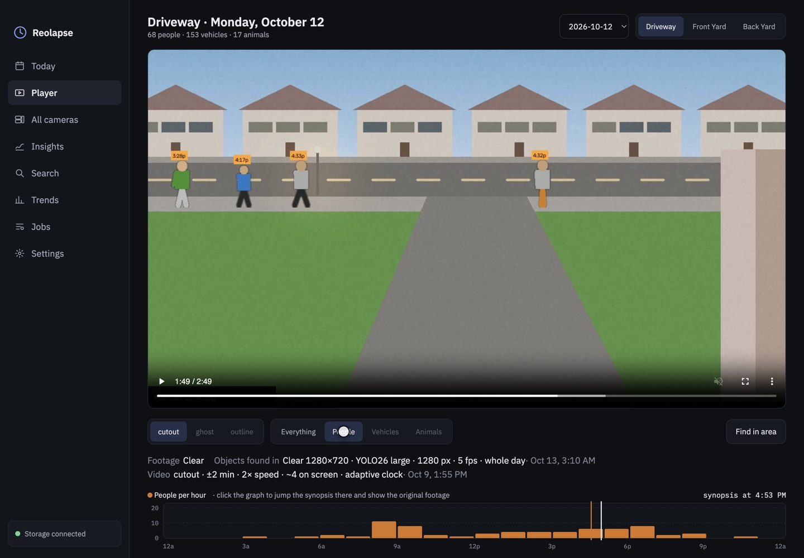
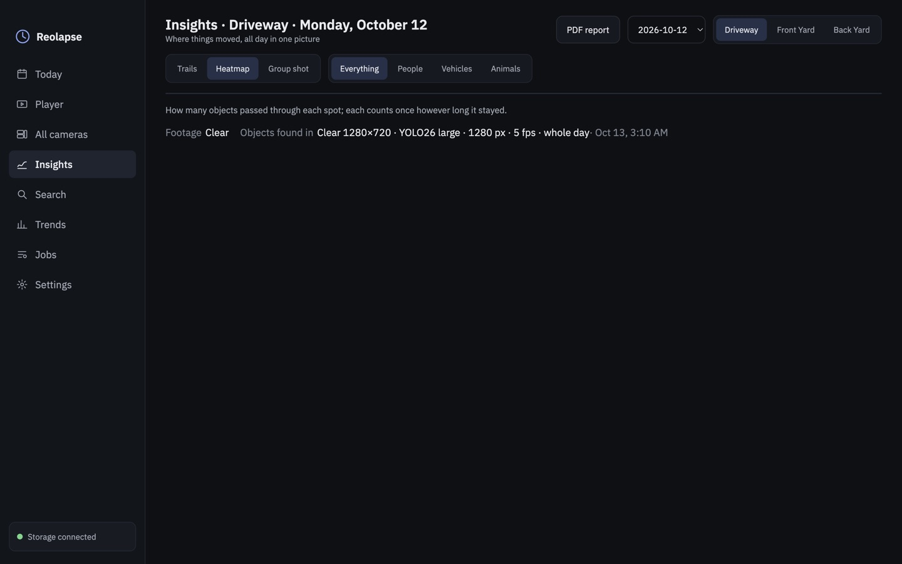
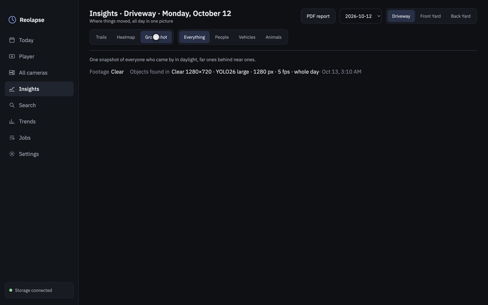
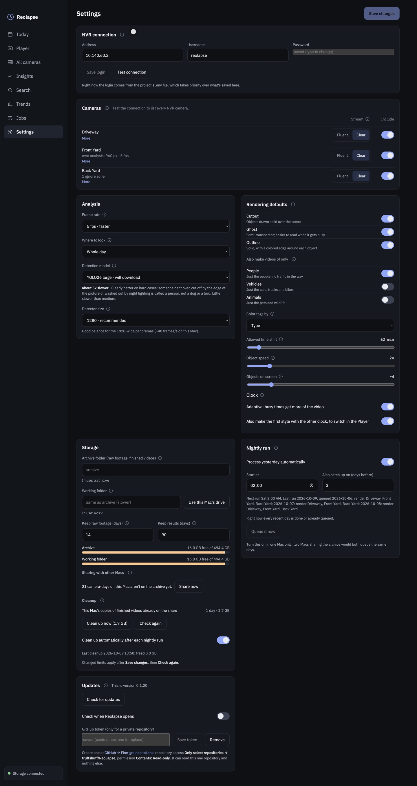
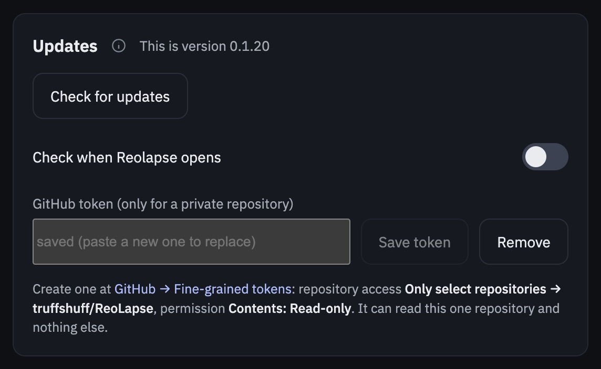

# Reolapse user guide

- [First run](#first-run)
- [Today](#today)
- [Player](#player) and [Find in area](#find-in-area)
- [All cameras](#all-cameras)
- [Insights](#insights)
- [Jobs](#jobs): lanes, pausing, logs
- [Settings](#settings): NVR, cameras and streams, analysis, rendering, storage, updates
- [What counts as a moving object](#what-counts-as-a-moving-object)
- [How long things take](#how-long-things-take)
- [Troubleshooting](#troubleshooting)

---

## First run

1. Install the app from the `.dmg` (see the [README](../README.md#install)); the first launch builds the
   analysis engine (about 1.5 GB; a setup window shows progress). It is stored in
   `~/Library/Application Support/Reolapse` and reused until the next version.
2. Open **Settings**:
   - **NVR connection**: the NVR's address, a username and password, then **Save login** and **Test
     connection**. Use a dedicated NVR user with viewing/playback rights. The password can't contain
     `& # %` or spaces (the NVR's web API breaks on them); it is kept in the macOS Keychain.
   - **Cameras**: after a successful test every NVR camera is listed; switch on the fixed ones you want.
   - **Storage**: the **archive folder** (where downloads and finished videos go, normally your NAS
     share) and the **working folder** (*Use this Mac's drive* is fastest).
   - **Save changes**.
   - **Updates** (optional): a read-only GitHub token so Reolapse can tell you about new versions
     and download them; see [Updates](#updates).
3. Open **Jobs**, pick yesterday, keep *Everything*, **Queue job**.

## Today


One card per camera for the selected day: a background image of the scene, a status (*Downloaded*,
*Analyzed*, *Ready*), counts of people, vehicles and animals, and a 24-hour activity chart. The ▶ on a
card opens it in the Player. Use ‹ › or the *Recent days* strip to change day.

## Player


- **Synopsis video**: the day's moving objects over a time-lapse of the scene. The clock (bottom left)
  shows the time of day the background is at; each object's tag shows its own real time.
- **Style**: *cutout* (solid), *ghost* (see-through, easier when busy), *outline* (colored edge).
  Which ones are rendered is set in Settings → Rendering defaults.
- **Show**: *Everything*, or a video of just the **People**, **Vehicles** or **Animals**. With fewer objects
  these are shorter and much easier to follow: no traffic in the way of the people on the driveway.
  Types that weren't seen that day aren't offered. A dimmed choice hasn't been rendered for that day
  yet: click it and **Make … video** queues it (a few minutes); it replaces the full video as soon as
  it's done. To get them for every day, switch them on in Settings → Rendering defaults.

  

- **Settings line** (under the controls; also on Insights): the footage on the share (*Clear* or
  *Fluent*, and how much of it is downloaded), what the objects were found in (stream, picture size,
  model, detector size, frame rate, when) and how the video was rendered. Days analyzed before v0.1.12
  show only the stream. If a day was analyzed on a different stream than the footage now downloaded
  (Fluent results, Clear footage), it says so: run *Find moving objects* again to use the new footage.
  Today's cards and the All cameras tiles show each camera's stream too.
- **Activity graph**: how many objects appeared in each hour, with a scale on the left; it follows
  **Show**, so with *Vehicles* selected it counts only vehicles. Hover a bar for its count. Click
  anywhere to jump the synopsis to that time **and** load the original recording from that moment below. The white line follows the synopsis; the orange line marks where
  the original footage is from.
- **Original footage**: or type a time and press **Go**.

### Find in area


Click **Find in area** and drag one or more boxes on the video (× removes one). Every object whose
center passed through a box is listed with a cutout, the time it entered, and how long it was on camera;
filter by type with the chips. Click a result to jump the synopsis there and show the original footage
from the moment it entered. **Done drawing** returns the mouse to the video controls; **Clear areas**
starts over.

The first search of a day that was analyzed before this feature existed builds a search index (a few
minutes); after that searches are instant.

## All cameras


The real recordings of every camera, starting at the same second, played together with **▶**;
**−30 s / +30 s** step through time, and the lanes under the videos show each camera's activity (click
a lane to jump to that hour).

**Detected near…** lists everything found on any camera within ±5, ±15 or ±60 minutes of the current
time. Clicking an event loads every camera from 5 seconds before it, outlines the camera it was on, and
plays them together: the way to follow someone from the driveway to the back yard.

Each camera's clip starts at its nearest keyframe, so cameras can be up to about two seconds apart.

## Insights


- **Trails**: every path of the day, colored by time (legend below the image).
- **Heatmap**: how many objects passed through each spot; each object counts once however long it stayed.

  

- **Group shot**: one daylight snapshot of each object, far ones behind near ones, tagged with times.

  

**Show** picks *Everything* or just the **People**, **Vehicles** or **Animals**: the people's paths
without the street traffic, or where the cars actually go. Every render makes these per-type pictures
(about 15 seconds each per camera). For days rendered before they existed, choose a type and click
**Make pictures for each type**: a pictures-only render for every camera of that day, about a minute per
camera, with no videos re-rendered.

## Jobs


**Process a day** queues work for a day and cameras. *Everything* becomes three jobs: **Download** →
**Find moving objects** → **Render**. Single steps are useful to redo part of a day, e.g. *Render* after
changing the styles in Settings. A single *Render* can be limited with **Only** (People, Vehicles or
Animals) to add just that video to an already rendered day, in a few minutes.

**Two lanes** run at the same time, one job each:

| Lane | Runs | Uses |
|---|---|---|
| Download | Download | the network (NVR → share) |
| Processing | Find moving objects, Render | the GPU and CPU |

So the next day can download while an earlier day is being analyzed. A day's steps always run in order:
its analysis waits for its download, its render for its analysis. A waiting job says why
("waits for this day's download (job 4)").

- **Up next**: ↑ ↓ reorder queued jobs (also while the queue is paused: pause, move a job to the top,
  resume, and it runs next); **Cancel** removes one.
- **Finished**: **Retry** re-queues a failed or cancelled job. Work already done is skipped (finished
  downloads are kept; analysis continues from its last checkpoint). **Remove** takes a job (and its log)
  off the list; **Clear finished** removes them all. Downloads, results and videos aren't touched.
- **Pause queue**: stops running jobs immediately and starts nothing new until **Resume queue**. Nothing
  is lost: downloads keep every finished file, and object finding saves a checkpoint every two minutes
  of footage and continues from there.
- **Automatic pause**: when the archive share can't be reached (for example the laptop left home or
  woke up elsewhere) the queue pauses itself, and resumes when the share is back.
- **Closing the window** keeps jobs running; **⌘Q** asks first, and running jobs continue next time
  Reolapse opens.

**Logs**: the selected job's log explains each step in plain language, for example
`[12/32] 08:00: downloaded 2.91 GB in 4m 12s (11.5 MB/s)` → `made seekable in 32s` → `copied to the
share in 1m 46s`. A live status line under the log shows the current download speed or scan position.
**Download full log** saves the complete log as a text file.

## Settings



Every setting has an ⓘ explaining it. Changes apply to jobs that start after **Save changes**.

### Cameras and streams

| | Fluent (sub stream) | Clear (main stream) |
|---|---|---|
| Example resolution | Garage 1920×576, Porch Left 640×360 | Garage 5120×1552, Porch Left 3840×2160 |
| Per camera per day | ~2–21 GB, ~10–60 min to download | ~36–90 GB, 45 min–2 h to download |
| Whole-day scan | ~45–90 min | ~3 h of decoding alone |
| Cutouts | soft | sharp |

Clear is decoded on the Mac's hardware decoder and scaled to 2560 px wide. If a camera's Fluent stream
is very small (Porch Left's 640×360), raising its sub-stream resolution in the Reolink app is often a
better trade than switching to Clear.

### Analysis

| Setting | What it trades |
|---|---|
| **Frame rate** | 5 fps is about twice as fast; 10 fps gives smoother motion and catches fast cars in more frames. |
| **Where to look** | *Whole day* scans 24 hours and runs the detector only when pixels change; catches everything. *NVR events only* scans just the NVR's person/animal/motion windows; much faster, misses vehicles that never overlapped one. |
| **Detection model** | *YOLO26 nano* (fastest, recommended), *small* (~2× slower, more distant objects), *medium* (~4× slower), *large* (~5×; much better at telling an awkwardly posed or half-visible person from an animal), *extra large* (~10×, the most accurate). Larger models download on first use. |
| **Detector size** | 960 fast; 1280 recommended; 1920 finds small/distant objects at about half the speed. |

### Rendering

Styles (one video each), tag colors (by type, or by time of day), **allowed time shift** (how far an
object may be moved from its real time to reduce overlap; 0 = exact), **object speed**, and **objects on
screen** (sets the automatic video length).

**Also render a video of only…** People / Vehicles / Animals: each switch adds one more video per camera
and day (in the first style), made with every Render from then on. They are quick: a people-only video
of a busy day renders in a minute or two.

### Storage

- **Archive folder**: downloads, NVR event lists, finished videos and stills (your share).
- **Working folder**: backgrounds, object data and rendering, which are many small reads and writes; a
  folder on the Mac is much faster than the share. About 1 GB per camera-day accumulates there.
  Finished outputs are copied to the archive.

### Updates

Reolapse can check its GitHub releases for a newer version. The repository is private, so it needs a
read-only token once:

1. On GitHub open **Settings → Developer settings → Fine-grained tokens → Generate new token**
   (or the link in the app).
2. **Repository access**: *Only select repositories* → `truffshuff/ReoLapse`.
   **Permissions**: *Contents: Read-only*. Pick an expiry (a year is fine).
3. Paste it into Settings → **Updates** → **Save token**. It's kept in the macOS Keychain.



With *Check when Reolapse opens* on, a newer version shows **Update available** in the sidebar.
**Download** saves the `.dmg` to Downloads and opens it: quit Reolapse (⌘Q; queued and running jobs
continue next time), drag Reolapse onto Applications, choose **Replace**, and open it again. The app
isn't signed by Apple, so it can't replace itself. Settings, the NVR login and processed days are kept;
the first launch of a new version rebuilds the engine (a minute or two).

## What counts as a moving object

Reolapse keeps people, vehicles and animals **while they move**. A parked car's detection box wobbles a
little from frame to frame, which can look like movement for a moment, so a **vehicle only counts if it
travels at least half its own size** (a car driving in or out of view covers far more). People and
animals aren't held to that: someone gardening or standing at the door barely travels but is real.
An object that stops for a few seconds ends; it continues as a new one when it moves again.

An object's type is decided from every frame it was seen in. The detector sometimes calls a person who
is bent over, cut off by the edge of the picture or washed out by night lighting a dog or a bird, but
rarely mistakes an animal for a person, so an "animal" that was a person in at least a third of its
frames counts as a person. Bigger models make this mistake much less: in one such case nano said person
in 12 of 25 frames, *large* in 22 and *extra large* in 24 (*medium* only 7).

Objects that don't pass the check are set aside in the day's `tubes/_pruned` folder rather than deleted.
Days analyzed with v0.1.2 or earlier still contain parked-car blips: either queue *Find moving objects*
for that day again, or (much faster) run the check on what's already there and then queue a *Render*:

```
"$HOME/Library/Application Support/Reolapse/engine/bin/python" -m reolapse prune --day 2026-09-28
```

## How long things take

Measured on an M2 MacBook over Wi-Fi to an SMB share:

| Step | Fluent | Clear |
|---|---|---|
| Download, Garage (1920×576 vs 5120×1552) | ~8 min, 5.8 GB | ~45 min, 36–60 GB |
| Find moving objects, whole day, 5 fps, nano | 45–90 min | several hours |
| Render, one style, all objects | 2–15 min | 2–15 min |
| Render, one type only (e.g. people) | 1–3 min | 1–3 min |

Heavier analysis settings multiply: 10 fps ×2, *medium* model ×4, detector size 1920 ×2. Wired Ethernet
to the share makes Clear processing several times faster than Wi-Fi.

## Troubleshooting

| Symptom | Cause and fix |
|---|---|
| macOS says the app "can't be opened" | It isn't notarized: System Settings → Privacy & Security → **Open Anyway**, or `xattr -dr com.apple.quarantine /Applications/Reolapse.app`. |
| Test connection fails / downloads 404 | Check the login; passwords with `& # %` or spaces don't work with the NVR API. Downloads retry automatically with a fresh login (the NVR's session expires after about an hour). |
| Footage loads slowly or pages show "Loading…" | A download is using the network (especially Clear). The note under the video says so; it speeds up when the download lane is idle. |
| The queue says "paused: the network share isn't reachable" | Mount the share (Finder → Go → Connect to Server). The queue resumes by itself. |
| Lots of "vehicles" that are really parked cars | The day was analyzed before v0.1.3: see [What counts as a moving object](#what-counts-as-a-moving-object). |
| The Jobs list is long | **Remove** on a finished job, or **Clear finished**. |
| A camera's day shows *Downloaded* but no objects | Its analysis hasn't run or failed: check Jobs → Finished, and **Retry**. |
| No recordings for a day | The NVR only keeps footage for a few days (fewer with Clear on every camera); queue recent days. |
| "GitHub refused the token" | It expired or lacks *Contents: Read-only* on the ReoLapse repository: make a new one (Settings → Updates). |
| Moving/tracking camera looks wrong | Pan/tilt/zoom lenses aren't supported: switch them off in Settings → Cameras. |
